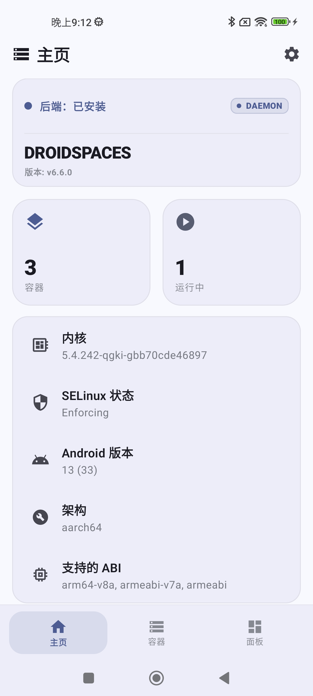
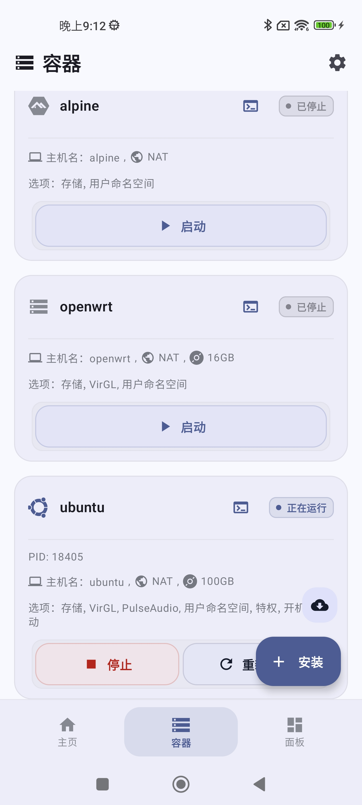
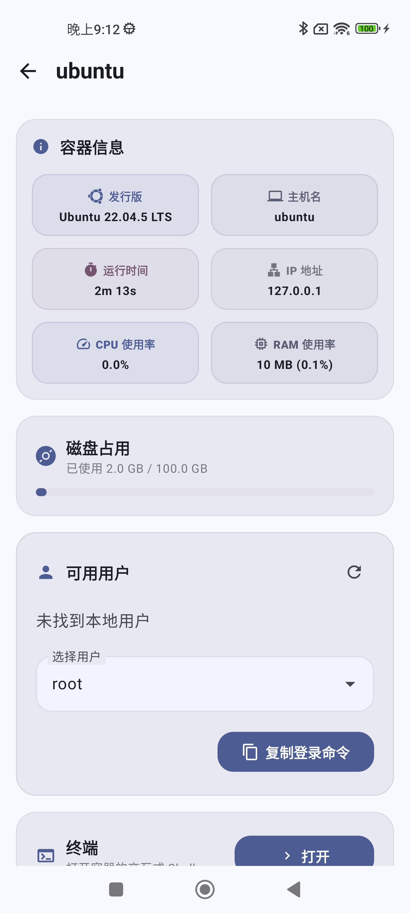
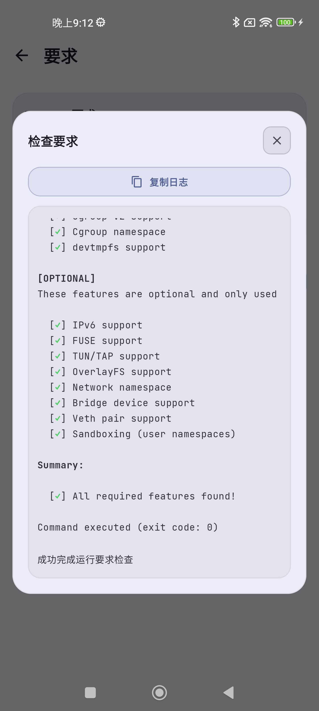
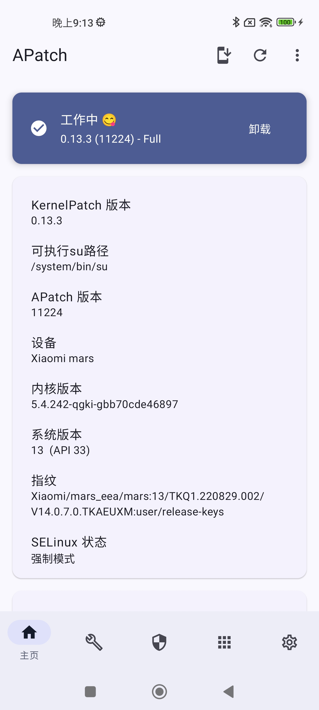
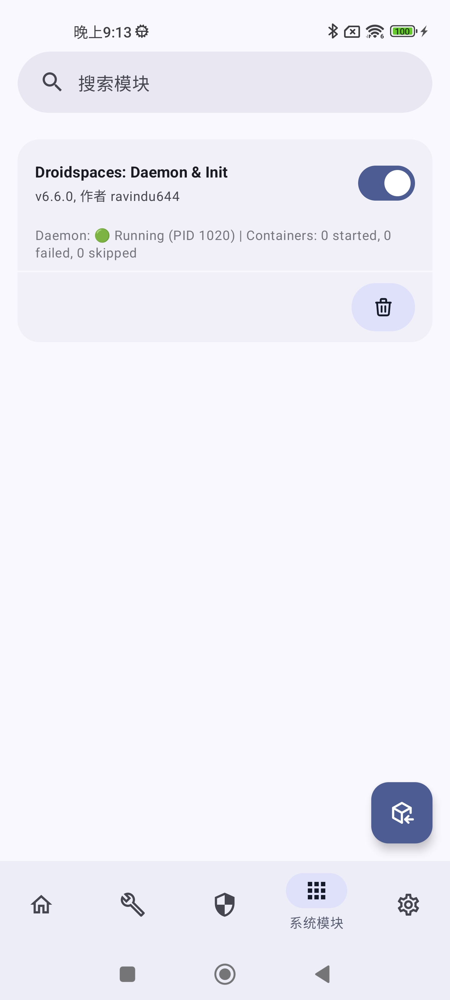
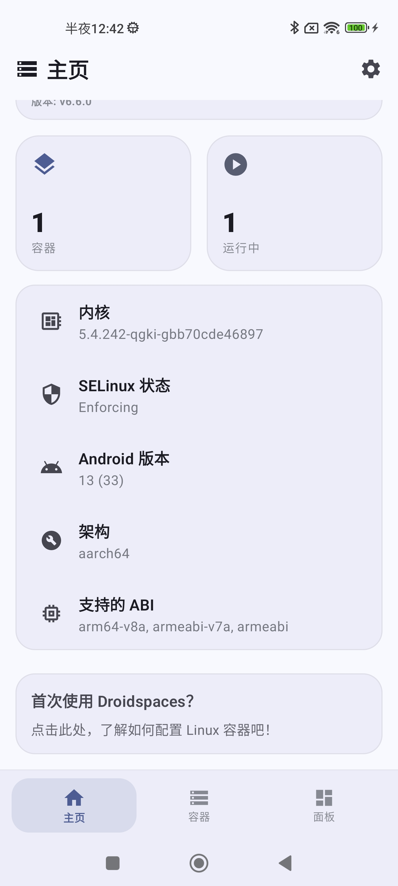

# mars-droidspaces-kernel（GitHub Actions 构建）

给 **Xiaomi Mi 11 Pro (`mars`, SM8350)** 编译带 **Droidspaces-OSS** 容器支持的自编内核。
构建全部在 GitHub Actions 完成，不需要本地编译环境。

---

## 🎉 当前基线（2026-10-19）：**los101-apatch-bbr** —— APatch + BBR

> **新的默认基线**：APatch root + BBR。内核基线 = **los96**（APatch 最后成功版，run `38245465726`），
> 只加 BBR 开关（`extra_config` 末尾加 `BBR` 标记）。**KernelSU v0.9.5 线保留为历史/可选，不再默认**
> （非 GKI 上限就停在 v0.9.5，已切回 APatch）。

| 能力 | 状态 |
|---|---|
| 进 MIUI / 触屏 / 电池 / 相机 | ✅ |
| WiFi（原厂 WLAN 栈 + `99-wlan-mars.sh`） | ✅（实测 `192.168.43.246`） |
| 音频出声（声卡注册 + tinyplay/框架播放） | ✅（los96 验收，los101 沿用） |
| **BBR**（`TCP_CONG_BBR=y` + 默认 `bbr` + `NET_SCH_FQ=y`） | ✅（真机 `tcp_congestion_control=bbr`） |
| APatch root（`u:r:magisk:s0`，`apd`） | ✅ |
| Droidspaces 容器（`droidspaces check` required 全过） | ✅ |

### 📸 真机截图（硬件状态延续；原图在 [`docs/screenshots/`](docs/screenshots)）

> 2026-10-12 los96 刷入验收后拍摄（Droidspaces App ×4 + APatch root 管理 ×2），
> 另附 2026-10-11 一张作对照。los101 为同一硬件栈 + BBR。

| | |
|---|---|
|  |  |
| *Droidspaces App · 10-12 21:12* | *Droidspaces App · 10-12 21:12* |
|  |  |
| *Droidspaces App · 10-12 21:12* | *Droidspaces App · 10-12 21:12* |
|  |  |
| *APatch root 管理 · 10-12 21:13* | *APatch root 管理 · 10-12 21:13* |
|  | |
| *Droidspaces App · 10-11（对照）* | |

**直接使用**：下载 [Release `los101-apatch-bbr`](../../releases/tag/los101-apatch-bbr) 里的
`boot-Image-los101-apatch-bbr.img` + `99-wlan-mars.sh`，按 [`docs/FLASH-GUIDE.md`](docs/FLASH-GUIDE.md) 刷入。
md5：`boot-Image-los101-apatch-bbr.img` = `f0c43b9970adee2a63ccf9b3c9d70142`；
`Image-los101-apatch-bbr` = `b10a6a1c0cf365aef30fcfc90a612593`。
⚠️ **镜像是净版（未打 root 补丁）**：刷前先用 APatch App“选择并修补一个文件”打补丁（或走
`flash-local.sh` 自动打），否则没有 root ⇒ `/data/adb/service.d/99-wlan-mars.sh` 不执行 ⇒ 无自动 WiFi。
**root 方案**：默认/基线 = **APatch**（容器需 `nr436-shim`）；**KernelSU v0.9.5 仅历史/可选**，不再默认。
**BBR 自检**：

```bash
adb shell 'zcat /proc/config.gz | grep -E "TCP_CONG_ADVANCED|TCP_CONG_BBR|DEFAULT_TCP_CONG|NET_SCH_FQ"; \
           cat /proc/sys/net/ipv4/tcp_congestion_control'
# 期望: =y / =y / "bbr" / =y；运行时 bbr
```

**文档索引**：
- [`docs/FLASH-GUIDE.md`](docs/FLASH-GUIDE.md) — **刷机指南与注意事项（唯一权威）**
- [`docs/AUDIO-EPIC.md`](docs/AUDIO-EPIC.md) — 音频攻坚全记录（根因/配方/验收证据/运维铁律）
- [`VERSIONS.md`](VERSIONS.md) — 权威版本/配方日志
- [`docs/mars-handover-CHECKLIST.md`](docs/mars-handover-CHECKLIST.md) — 全部实验流水
- [`AGENTS.md`](AGENTS.md) — 操作手册（硬约束/环境/血泪坑）
- [`docs-flash-guide.md`](docs-flash-guide.md) — 旧版指南指针（内容已迁移）

---

## 为什么需要这个内核

设备出厂内核（`5.4.233-qgki-gbb70cde46897`）关闭了容器所需的关键选项：

```
CONFIG_SYSVIPC / POSIX_MQUEUE / IPC_NS / PID_NS / CGROUP_DEVICE / DEVTMPFS / USER_NS ...
```

这些是**编译期**开关，只能重编内核才能打开。

## 核心难点与做法

### 1. GKI kABI 兼容（Droidspaces 官方补丁）

打开 `CONFIG_SYSVIPC` / `CONFIG_POSIX_MQUEUE` 会改变 `task_struct` / `user_struct` 的内存布局，
导致厂商预编译模块崩溃/开机循环。`patches/` 的补丁把字段挪进 `ANDROID_KABI_*` 保留槽位，
**不改变内存布局**。

| 补丁 | 作用 |
|---|---|
| `001.GKI-below-6.12-fix_sysvipc_kabi_*.patch` | SYSVIPC → `ANDROID_KABI_USE(6/7/8)` |
| `002.5.10_or_lower_..._posix_mqueue.patch` | POSIX_MQUEUE `mq_bytes` → `ANDROID_KABI_USE(1)` |

### 2. ⚠️ 厂商模块不可能整体复用（已验证）

即使版本字符串与配置全对齐，**原厂带 CRC 的模块仍无法加载**（`module_layout` CRC 不匹配 583/940）：
本仓上游源码与小米内部树**不是同一棵树**。

### 3. 因此：把驱动编进内核 + 选择性保留原厂 DLKM

- 触控/指纹/存储/显示/电源等全部 `=y` 内建（`allbuiltin=1` + 专项 `force_m/force_y`）。
- **WiFi 用原厂栈**：`cnss2.ko` → CBC 校准 → `qca_cld3_wlan.ko`（顺序敏感，由 `99-wlan-mars.sh` 完成）。
- **音频（los96 最终解）**：cs35l41 功放驱动**同源内建**（TDM 宏修正上电配置）+ `cs35l41-i2c.c`
  的 snd_event 调用**三处打桩**（保证原厂 `snd_event_dlkm` 正常装载、依赖链完整），
  其余音频 DLKM 用原厂。详见 [`docs/AUDIO-EPIC.md`](docs/AUDIO-EPIC.md)。

### 4. 仍为模块的部分

高通 **techpack** 部分模块由外部 Makefile 以 `obj-m` 构建；设备**没有 `vendor_dlkm` 分区**，
模块位于 `super` 里 `vendor` 逻辑分区的 `/vendor/lib/modules/`，无法单独刷模块分区。

## 构建（当前工作流 `los.yml`）

```bash
python3 /tmp/ghdisp2.py los.yml '{"config":"mars_factory.config","logdump":"1","wlanblock":"1",
  "ignore_vermagic":"1","mi_syms":"1","kabi":"1","allbuiltin":"1",
  "force_m":"CNSS2,CNSS_GENL,WCNSS_MEM_PRE_ALLOC","force_y":"CNSS_QCA6490",
  "hwid_deexport":"1","modules":"1","firmware_embed":"1","los_commit":"d42d2eb6c",
  "mi_syms_audio":"1",
  "extra_config":"-d PANIC_ON_OOPS,-d QCOM_FORCE_WDOG_BITE_ON_PANIC,-d PANIC_ON_SSR_NOTIF_TIMEOUT,-d DEBUG_POWER_MI,-e DETECT_HUNG_TASK,--set-val DEFAULT_HUNG_TASK_TIMEOUT 15,BBR"}'
```

- 基线：LineageOS `android_kernel_xiaomi_sm8350@d42d2eb6c`（5.4.242）
- 真机原厂 config：`configs/mars_factory.config`；产物带 `ignore_vermagic` + MIUI 符号桩
- **BBR**：`extra_config` 末尾的 `BBR` 标记会打开 `TCP_CONG_ADVANCED=y`、`TCP_CONG_BBR=y`、
  `NET_SCH_FQ=y`，并把 `DEFAULT_TCP_CONG` 设为 `bbr`；不加标记 = los96 原样（BBR 关）。
- **root**：不加 `KSU` 标记 = APatch 内核（当前默认，run `39174084270` / `los101-apatch-bbr`）；
  加 `KSU` 才是历史 KernelSU v0.9.5 线。
- 历史工作流 `build.yml`（早期 5.4.191 上游树方案）仅作存档

## 刷机

**一律 `fastboot flash boot_a `**（活动槽 `_a`；`fastboot boot` 在本机不可用）。
**默认 APatch 方案**：净版 boot → APatch App 打补丁 → 刷 `boot_a`；KSU 线仅历史/可选。
完整步骤、注意事项、救机、验收见 [`docs/FLASH-GUIDE.md`](docs/FLASH-GUIDE.md)。

## 🧩 ★新装容器必做：`nr436-shim`（NAT 联网的钥匙）

> **每新装/新导入一个容器 rootfs，都要装一次 `nr436-shim`**，否则现代 systemd/glibc 发行版
> (Ubuntu/Debian/…) 的服务全部起不来 ⇒ 没 DHCP ⇒ "NAT 模式网络不通"。
>
> ```bash
> adb push nr436-shim /sdcard/ && adb push patches/nr436-shim-install.sh /sdcard/
> adb shell 'su -c sh /sdcard/nr436-shim-install.sh <容器名>'    # 一键, 幂等, 可重复跑
> ```
>
> 根因(一句话)：APatch 的 KernelPatch 隐藏系统调用 supercall 占了 **436 号**，与 glibc 的
> `close_range` 编号相撞，systemd 收 EINVAL 不回退导致服务全灭。shim 用 seccomp 把 436 改道
> 成 ENOSYS(保留 supercall 魔数调用) ⇒ systemd 走 /proc 回退 ⇒ 全活 ⇒ NAT 自动通。
> **完整清单/失败救援/卸载/源码见 [docs/CONTAINER-NET.md](docs/CONTAINER-NET.md)**。

## 目录

```
.github/workflows/los.yml        当前构建工作流（GOLD 配方）
.github/workflows/build.yml      早期工作流（存档）
configs/                         mars_factory.config 等内核配置
patches/                         kABI/音频/WLAN/诊断等全部补丁脚本
firmware/                        内建固件（EXTRA_FIRMWARE）
ref/ tools/                      boot 打包参考件与工具
docs/                            刷机指南 / 音频史诗 / 实验流水
VERSIONS.md AGENTS.md            权威日志 / 操作手册
```

## 参考

- [Droidspaces-OSS 内核配置指南](https://github.com/ravindu644/Droidspaces-OSS/blob/main/Documentation/Kernel-Configuration.md)
- [LineageOS kernel_xiaomi_sm8350](https://github.com/LineageOS/android_kernel_xiaomi_sm8350)
- [KernelSU](https://github.com/tiann/KernelSU)

## 许可

配置与工作流脚本：MIT。内核源码沿用上游 GPL-2.0。
